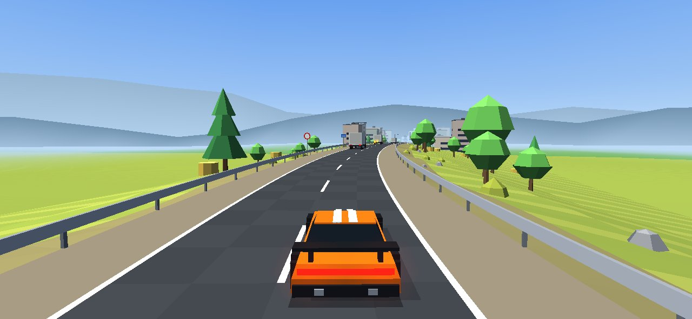
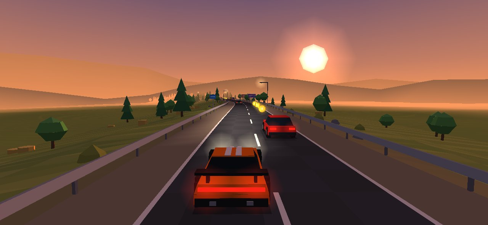
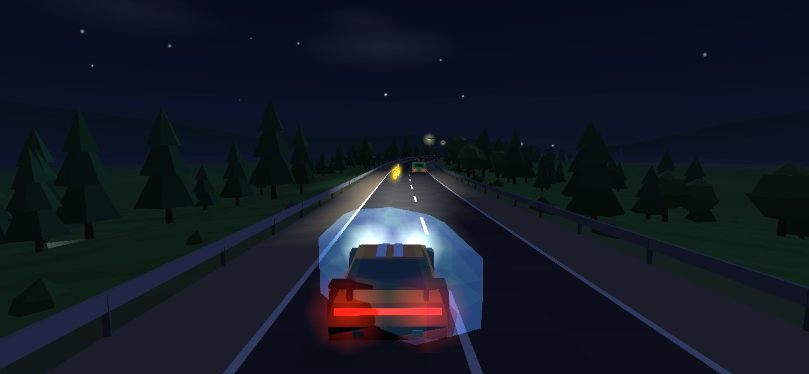
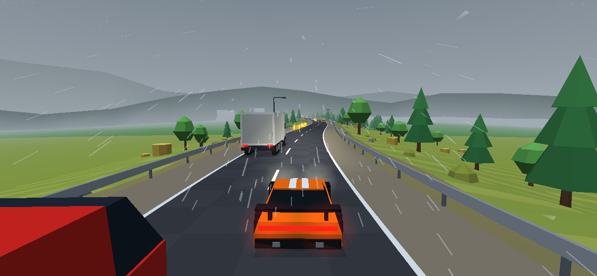
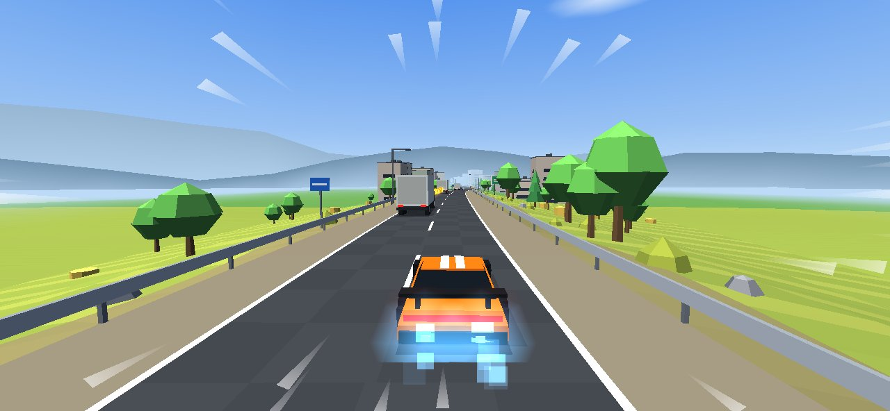
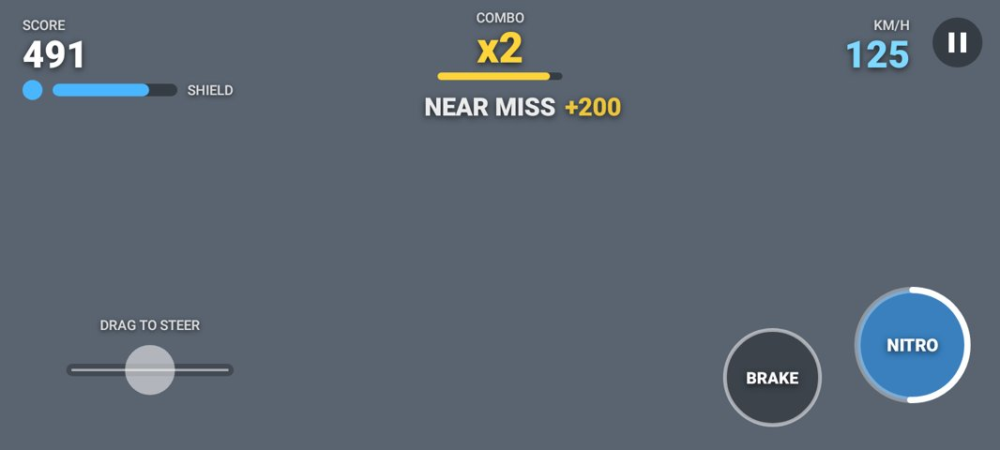

# Endless Drive

A 3D third-person endless driving game for Android. Chase camera behind the car, a two-lane
one-way road with shoulders and guard rails, analog steering, traffic to weave through.
Score = distance + coins + near-miss bonuses.

Kotlin + OpenGL ES 2.0, no engine. Every model, the scenery and all sound are generated in code:
the repository contains no art or audio assets.

| | |
|---|---|
|  |  |
|  |  |
|  |  |

The 3D frames above come from the desktop preview harness (same renderer code, software GL);
the HUD frame is the Android UI layer rendered by Robolectric, which has no GPU, hence the grey
background. See "What was verified" in [DECISIONS.md](DECISIONS.md).

## How to play

* **Steer**: drag left/right anywhere on the left half of the screen (analog), or switch to tilt
  in Settings.
* **Brake** and **Nitro** buttons on the right. Nitro lasts 2.5 s, then recharges for 7 s.
* Throttle is automatic. Driving on the shoulder slows you down; the guard rail is a crash.
* Pass traffic closely at speed for near-miss bonuses; chain them for a combo multiplier (up to x8).
* Coins are worth 50. A shield absorbs one hit and lasts 5 s.

## Requirements

* JDK 17 or newer (built here with JDK 21)
* Android SDK with `platforms;android-36` and `build-tools;35.0.0`
* Network access to Google's Maven (`dl.google.com`, `maven.google.com`) and Maven Central

Tell Gradle where the SDK is with `ANDROID_HOME` or a `local.properties` containing `sdk.dir=...`.
SDK from scratch on Linux:

```bash
mkdir -p $HOME/android-sdk/cmdline-tools && cd $HOME/android-sdk/cmdline-tools
curl -sSO https://dl.google.com/android/repository/commandlinetools-linux-13114758_latest.zip
unzip -q commandlinetools-linux-*_latest.zip && mv cmdline-tools latest
yes | latest/bin/sdkmanager --licenses
latest/bin/sdkmanager "platform-tools" "platforms;android-36" "build-tools;35.0.0"
export ANDROID_HOME=$HOME/android-sdk
```

## Build (one command)

```bash
./gradlew build
```

That compiles everything, runs all unit tests (core logic + Robolectric) and Android lint, and
produces:

| Output | Path |
|---|---|
| Debug APK (installable) | `app/build/outputs/apk/debug/app-debug.apk` |
| Release APK (R8-minified, resources shrunk, **unsigned**) | `app/build/outputs/apk/release/app-release-unsigned.apk` |

Other tasks:

```bash
./gradlew :app:assembleDebug          # just the debug APK
./gradlew :app:bundleRelease          # release AAB (unsigned)
./gradlew :core:test                  # game-logic tests only (fast, no Android)
./gradlew :app:testDebugUnitTest      # Robolectric flow/lifecycle/ads tests + UI screenshots
./gradlew :app:lintDebug              # report: app/build/reports/lint-results-debug.html
xvfb-run -a ./gradlew :desktop:shots  # render real 3D frames to desktop/build/shots (Linux, needs Mesa)
```

## Install and run

```bash
adb install -r app/build/outputs/apk/debug/app-debug.apk
adb shell am start -n com.endlessdrive.game/.MainActivity
```

## Signing a release

```bash
$ANDROID_HOME/build-tools/35.0.0/zipalign -p 4 app/build/outputs/apk/release/app-release-unsigned.apk aligned.apk
$ANDROID_HOME/build-tools/35.0.0/apksigner sign --ks my.keystore --out endless-drive.apk aligned.apk
```

## Ads

All ad identifiers and the privacy-policy URL live in **`app/ads.properties`** and nowhere else.
They are Google's public test ids and a placeholder URL: replace them before publishing.
The game is fully playable offline or with ads blocked.

## Layout

```
core/     pure Kotlin, no Android: road, steering, traffic spawner + AI, collisions, scoring,
          difficulty, day/weather cycle, particles, ad-frequency policy. All unit tests for rules.
engine/   pure Kotlin renderer written against a 20-method Gl interface: procedural models,
          streamed road chunks, sky, lighting, glows, particles, rain, speed lines.
app/      Android: GLSurfaceView + GLES20 backend, HUD and touch/tilt input, synthesised audio,
          haptics, screens, persistence, AdMob + UMP.
desktop/  LWJGL backend for the same engine: headless preview/screenshot + perf harness.
          Not part of the APK.
```
